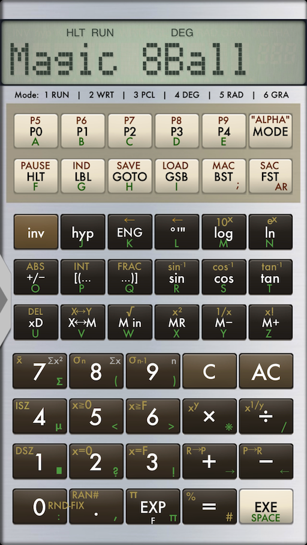

# Magic 8 Ball

Re-live the antics of the original Magic 8 Ball, now ported to Casio FX-602P Programmable Calculator. Instead of a white plastic icosahedron (a polyhedron with 20 faces) die, floating in alcohol dyed dark blue, the calculator uses a pseudo-random number generator to determine which message to display on the LCD screen. In the past, the only way to ensure a random message would be to shake the ball first. With this version, that's no longer necessary.

To use, run the program, then think of a yes or no question you would like answered. Press the Shake button below the screen. Look to see your answer revealed. Ask as many questions as you like, repeating this process. To exit, press the Exit button.

This version of the Magic 8 Ball uses a subset of the original 20 responses used in the real toy, broken down into 4 positive (afirmative), 2 neutral, and 3 negative answers to select from, due to the limit of 10 jump labels per program. You'll be sure to see some of the same familiar replies to those viewed in the past. The answers utilize multiple screen displays due to the limited number of characters per line on the display.

  
Positive | Neutral | Negative
:-:      | :-:     | :-:
It is very certain. | Cannot predict. | Better not tell you.
It is decidedly so. | Ask me again later. | Outlook not good.
Most likely. |  | Very doubtful.
Outlook good. |  | 

