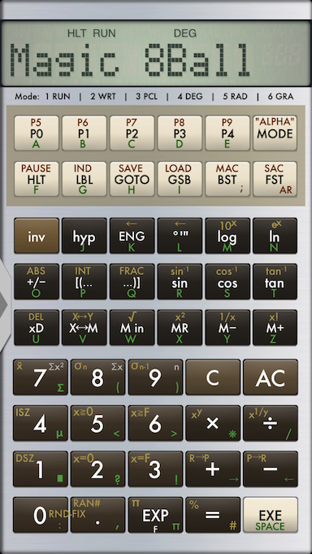

# Magic 8 Ball

Re-live the antics of the original Magic 8 Ball, now ported to the Casio FX-602P. Instead of a white plastic icosahedron (a polyhedron with 20 faces) die, floating in alcohol dyed dark blue, the calculator uses a pseudo-random number generator to determine which message to display on the LCD screen. In the past, the only way to ensure a random message would be to shake the ball first. With this version, that's no longer necessary.

To use, press P1 to run this program. It will display "Magic 8Ball" and then wait. Think of a yes or no question, then press the EXE button to get your answer. Ask as many questions as you like, pressing the EXE button for each to get your response.

This version of the Magic 8 Ball uses the same collection of 20 responses as the original, broken down into 10 positive (afirmative), 5 neutral, and 5 negative answers to select from. You'll be sure to see the same familiar responses to those observed in the past. To add realism, the answers shown on screen are split across multiple lines between words, just as the original, in order to fit within the triangular face of the die.

  
Positive | Positive | Neutral | Negative
:-:      | :-:      | :-:     | :-:
It is certain. | As I see it. | Reply hazy, try again. | Don't count on it.
It is decidedly so. | Most likely. | Ask me again later. | My reply is no.
Without a doubt. | Outlook good. | Better not tell you now. | My sources say no.
Yes, definitely. | Yes. | Cannot predict now. | Outlook not so good.
You may rely on it. | Signs point to yes. | Concentrate and ask again. | Very doubtful.

